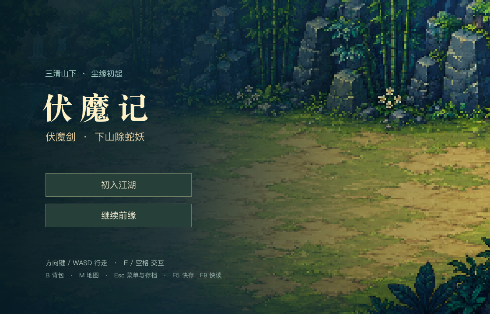

# 伏魔记 · 经典重制

彩色 2D、中文、离线单机、回合制。保留经典版的主线、支线和结局，包含游戏数据，无需安装 Godot 或另行导入资源。

**[下载 Windows 版](https://github.com/zhongguohaoqingnian-dev/fmj-classic/releases/latest/download/FMJClassic-0.6.2-Windows.zip)** · **[下载 Mac 版](https://github.com/zhongguohaoqingnian-dev/fmj-classic/releases/latest/download/FMJClassic-0.6.2-macOS.zip)**



## 开始玩

- **Windows 10/11（64 位）**：下载并完整解压，双击 `FMJClassic.exe`。保留旁边的 `.pck` 文件。
- **macOS 12 及以上（Apple 芯片 / Intel）**：下载解压，将 `伏魔记.app` 拖到“应用程序”，双击打开。
- 当前包没有商业代码签名或 Apple 公证，系统可能提示开发者无法验证。请核对本仓库来源及校验和；Mac 可按系统“隐私与安全性”中的提示批准打开。

## 操作

| 按键 | 功能 |
|---|---|
| 方向键 / WASD | 移动 |
| E / 空格 | 交互、继续对话 |
| B | 背包 |
| M | 地图 |
| Esc | 菜单、存读档 |
| F5 / F9 | 快速保存 / 读取 |

存档自动保存在当前系统用户的数据目录，与开发版本分开。更新时替换程序，保留系统用户目录即可。游戏不需要联网或注册账号。

## 关于这个版本

这是独立整理的经典重制版，不含后续续作、HD2D 场景实验、开发任务记录、测试存档或私有提交历史。采用已选 C-FMJ/E-CLASSIC 剧情数据与现有 0.6.1 成品玩法；保留为正常游玩做过的数值调整，并非旧机数值逐点模拟。部分动作仍比较简朴。

原本地版本已有三条不同主要选择从新档到结局的自动流程与精确重放记录。本公开版本的具体检查见 [验证记录](docs/VALIDATION.md)。Windows 的跨平台导出与 Windows 本机实际运行是两项不同检查，按记录说明。

## 源码与构建

使用 **Godot 4.7.2.stable.official.ed1daf0bf**，打开根目录 `project.godot`，直接运行。导出需安装同版本官方模板；构建脚本仅使用 Python 标准库。

```sh
python3 tools/build.py --platform all --godot /path/to/Godot
```

下载包和校验和生成于 `builds/`。Linux 上可打开源码运行，目前只提供 Windows 与 Mac 成品。

这是非官方重制。原创程序采用 MIT；原作数据和第三方素材不自动适用 MIT，详情见 [第三方声明](THIRD_PARTY_NOTICES.md)。
